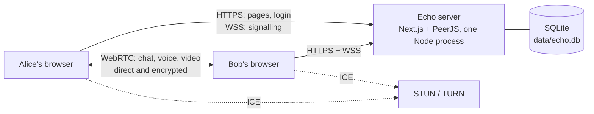

# Echo

Chat and call the people you know, browser to browser.

Echo's server handles accounts and introductions. Messages, voice and video go
**directly between the two browsers** over WebRTC and never pass through it.
Everything wears a soft watercolor theme that each person picks for themselves.

## Features

- **Accounts.** Sign up with a username and password. Your username is
  permanent; your display name and profile photo can change any time.
- **Profile photos.** Upload, crop and zoom in a pop-up; the photo shows
  everywhere your name does.
- **Contacts.** Add people by username. Anyone who isn't a contact shows up as
  a request you can accept or decline. Contacts are saved to your account.
- **Presence.** See which contacts are online right now.
- **Chat.** Text messages sent directly to the other person, with unread counts
  and history kept in your browser.
- **Voice and video calls.** Direct calls with mute, camera on/off and hang up.
- **Groups.** Group chats of up to 12 people and group calls of up to 4. The
  creator owns the group and chooses admins, who can add and remove people and
  rename it. Members who were offline catch up from whoever is online with them.
- **Devices.** See every device logged in to your account, log one out, or log
  out everywhere.
- **Themes.** Five watercolor palettes (Lagoon, Sage, Peony, Apricot,
  Wisteria), each with light and dark versions.

## How it works



1. You log in. The server checks your password and gives your browser a
   session cookie.
2. Your browser opens a WebSocket to the PeerJS signalling server, registered
   under your user ID. The server refuses the socket unless the session is
   valid, the request comes from Echo's own address, and the ID is yours.
3. To chat or call, your browser asks the signalling server to pass a WebRTC
   offer to the other person. Once both sides have swapped connection details
   (with help from STUN, or TURN on strict networks), they talk directly.
4. From then on, messages and media flow browser to browser. The server only
   tracks who is online.

## Tech stack

| Part | Choice |
| --- | --- |
| App | [Next.js 16](https://nextjs.org) (App Router, Server Actions), React 19, TypeScript |
| Styling | Tailwind CSS 3 with CSS-variable color tokens |
| Real time | [PeerJS](https://peerjs.com) in the browser, the `peer` signalling server, WebRTC |
| Server | A custom Node server (`server.ts`) running Next.js and PeerJS together, with Express for PeerJS's routes |
| Database | SQLite through Node's built-in `node:sqlite`, so there's no native module to build |
| Passwords | scrypt from `node:crypto` |
| Dev tooling | `tsx` and `nodemon` |

## Getting started

You need **Node.js 26** (the version is pinned in `.nvmrc`).

```bash
nvm use          # if you use nvm
npm install
npm run dev
```

Open <http://localhost:3000> and create an account. The database
(`data/echo.db`) is created on first use, and migrations run automatically.

### Trying two people on one computer

Two tabs on the same address share one login, so use separate addresses. Each
`*.localhost` name keeps its own cookies and chat history:

- <http://alice.localhost:3000>
- <http://bob.localhost:3000>

A private window works too. Both people need to be online at the same time,
because messages go directly between browsers.

### Scripts

| Command | What it does |
| --- | --- |
| `npm run dev` | Starts `server.ts` with `tsx` under `nodemon`. Restarts when `server.ts` or anything in `lib/` changes; Next.js reloads the rest. |
| `npm run build` | Builds the Next.js app, then compiles `server.ts` to `dist/`. |
| `npm start` | Runs the production server (`node dist/server.js`). |

## Configuration

Set these as environment variables. None are needed for local development.

| Variable | Default | What it does |
| --- | --- | --- |
| `PORT` | `3000` | Port for pages, the API and signalling. |
| `NODE_ENV` | `development` | `npm start` sets it to `production`, which marks session cookies `Secure`. |
| `ECHO_DB_PATH` | `data/echo.db` | Where the SQLite database lives. |
| `APP_ORIGIN` | the request's own host | Echo's public URL, such as `https://echo.example.com`, when a proxy changes the `Host` header. Signalling sockets from any other origin are refused. |
| `STUN_URLS` | `stun:stun.l.google.com:19302` | Comma-separated STUN servers. |
| `TURN_URLS` | none | Comma-separated TURN servers, such as `turn:turn.example.com:3478`. |
| `TURN_SECRET` | none | coturn's `static-auth-secret`. With `TURN_URLS`, Echo hands out TURN credentials that last 12 hours. |

## Deploying

```bash
npm ci
npm run build
PORT=3000 npm start      # runs in production mode
```

What a public deployment needs:

- **HTTPS.** Browsers only allow calls and camera access on secure pages.
- **WebSocket support** in your proxy, for signalling at `/peerjs`.
- **A proxy that overwrites `X-Forwarded-For`** with the real client address
  rather than passing on what the client sent. Echo uses it for login rate
  limits.
- **A TURN server** for people on mobile or office networks that block direct
  connections. Without one, some chats and calls won't connect.
- **Backups** of `data/echo.db`. Keep the file private: it holds password
  hashes and profile photos.

### Example nginx site

```nginx
map $http_upgrade $connection_upgrade {
    default upgrade;
    ''      close;
}

server {
    listen 443 ssl;
    server_name echo.example.com;
    # ssl_certificate and ssl_certificate_key go here

    location / {
        proxy_pass http://127.0.0.1:3000;
        proxy_http_version 1.1;
        proxy_set_header Upgrade $http_upgrade;
        proxy_set_header Connection $connection_upgrade;
        proxy_set_header Host $host;
        proxy_set_header X-Forwarded-For $remote_addr;   # overwrite, don't append
        proxy_set_header X-Forwarded-Proto $scheme;
    }
}
```

### Example coturn settings

```ini
use-auth-secret
static-auth-secret=<the same value as TURN_SECRET>
realm=echo.example.com
no-cli
no-multicast-peers
# Stop the relay from being used to reach machines on your own network.
denied-peer-ip=10.0.0.0-10.255.255.255
denied-peer-ip=172.16.0.0-172.31.255.255
denied-peer-ip=192.168.0.0-192.168.255.255
denied-peer-ip=127.0.0.0-127.255.255.255
# Limit how much one account can use.
user-quota=12
total-quota=1200
```

Then set `TURN_URLS=turn:turn.example.com:3478` and the same `TURN_SECRET` on
the Echo server.

## Project structure

```text
server.ts                    HTTP server: Next.js, PeerJS signalling, socket checks, presence
proxy.ts                     Sends visitors without a session cookie to /login
lib/
  db.ts                      SQLite connection and migrations
  users.ts, contacts.ts      Users, profile updates, contact lists
  avatars.ts                 Profile photo storage and file-type checks
  presence.ts                Who is online (in memory)
  profile-rules.ts           Username and display-name rules
  auth/                      Passwords, sessions, cookies, devices, login rate limits
app/
  layout.tsx                 Root layout; applies the user's palette before first paint
  globals.css                Color tokens, paper texture, buttons and fields
  theme/palettes.ts          The watercolor palettes (one list)
  (auth)/                    Login and sign-up pages
  (app)/                     Signed-in pages
    layout.tsx               App shell: header, notices, connection provider
    home.tsx                 Contacts, requests and chat
    settings/                Profile, photo pop-up, theme, devices
    _chat/                   Connection, chat and call logic (use-echo.ts) and UI
  actions/                   Server Actions: auth, contacts, settings, sessions
  api/                       User lookup, profile photos, ICE servers
```

## Data and privacy

| Where | What |
| --- | --- |
| Echo's database | Usernames, display names, password hashes (scrypt), palette choice, contacts, profile photos, group names and who is in each group with their role, and for each login: a hash of the session token, the browser's user agent, IP address and last-active time. |
| Your browser | Chat history, in IndexedDB, separately for each account. A new browser or device starts with an empty history. |
| Nowhere on the server | Message text and call audio or video, including in groups. They go straight between browsers. |
| The other person | Your IP address. Direct WebRTC connections need it, as in any peer-to-peer app. |

## Security

What Echo already does:

- Passwords are hashed with scrypt and compared in constant time. A wrong
  username takes as long to reject as a wrong password.
- Session tokens are random, stored only as SHA-256 hashes, and kept in
  `HttpOnly`, `SameSite=Lax` cookies that are `Secure` in production.
- Every Server Action and API route checks the session itself. `proxy.ts` is
  only a convenience redirect, not a security boundary.
- Five failed logins for a username from one IP lock it for 15 minutes.
- The signalling server only accepts a logged-in user, from Echo's own origin,
  under their own user ID.
- Profile photos must really be PNG, JPEG or WebP, judged by their bytes rather
  than their name, and at most 512 KB. They're served only to logged-in users,
  with `nosniff` and a locked-down Content Security Policy.
- Data from the other browser is checked before use and shown as plain text.
- Usernames can't be changed, so the name people add you by always means you.

Known gaps to close before running Echo publicly:

- [ ] The login rate limit trusts `X-Forwarded-For`, so it can be dodged unless
      a proxy overwrites that header. Registration and username lookups have no
      limits yet.
- [ ] Anyone with an account who knows your username can see when you're online
      and, by sending a chat request, learn your IP address.
- [ ] No security headers yet: add `Content-Security-Policy`,
      `frame-ancestors 'none'`, HSTS and `Referrer-Policy`.
- [ ] Display names can imitate other people. Usernames are shown next to them
      in requests, but not everywhere.
- [ ] Contacts can't be removed or blocked.
- [ ] Group messages that reach you through another member's catch-up sync
      aren't signed, so a dishonest member could pass on a message that
      claims to come from someone else in the group.

## Troubleshooting

| Problem | Fix |
| --- | --- |
| "Echo is open in another tab or window" | An account can be connected in one place at a time, across all devices. Close Echo in the other tab or on the other device, then reload. |
| "Echo needs your camera and microphone" | Allow access in the browser's address bar. Calls only work over https, or on `localhost`. |
| Chats or calls never connect for some people | Their network blocks direct connections. Set up TURN (see [Deploying](#deploying)). |
| Pages keep reloading in a loop | `npm run build` ran while `npm run dev` was running. Restart the dev server. |
| "Another next dev server is already running" | Only one dev server can run per project folder. Stop the other one first. |
| Type errors in `.next/…/validator.ts` after switching branches | Next's generated route types are stale. Restart the dev server, or delete `.next/types`. |
| You want a fresh start | Stop the server and delete `data/echo.db`. Every account and contact is removed. |

## Known limitations

- **No password reset.** There's no email, so a forgotten password can't be
  recovered.
- **No offline delivery.** Messages only arrive while both people are online,
  and history doesn't sync between devices.
- **One open window per account.** You can be logged in on several devices,
  but only one tab, on one device, can be connected at a time. Opening Echo
  somewhere else shows "Echo is open in another tab or window".
- **One server process.** Presence and login rate limits live in memory, so they
  reset on restart and don't work across several servers.
- **Group catch-up needs overlap.** A missed group message only reaches you
  when someone who has it is online at the same time as you, and only for the
  last 30 days.
- **Group calls connect everyone to everyone,** so they're capped at 4 people.
- **No message search or file sharing yet.**
